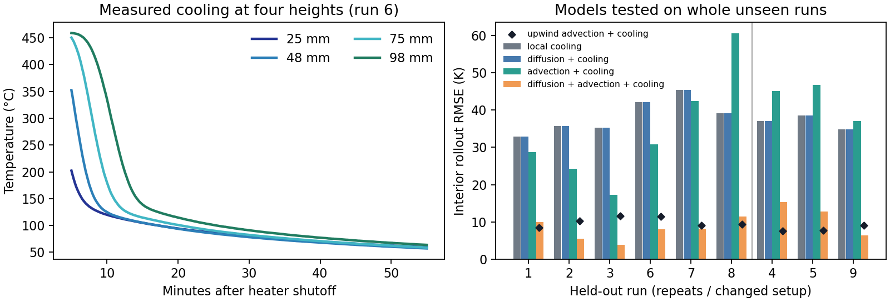

# Packed-bed heat transport

**Can a model fitted to earlier cooling runs predict temperatures inside a porous bed on a whole unseen run?** This case uses nine measured cooling experiments from Weber et al. at DLR and RWTH Aachen. Air flows upward through ceramic particles. Twenty calibrated thermocouples measure temperatures at four heights and five radial locations per height. The data include two cooling flow rates, a heater replacement and two runs with an inlet obstruction. [Source data and license](https://doi.org/10.17632/3pp86gdvh4.2) · [Apparatus and measurement uncertainty](https://doi.org/10.1016/j.dib.2025.111743)



## Model and split

Fit the effective axial equation $T_t = D T_{zz} - v T_z - k(T-T_0)$ with nonnegative coefficients. Compare local cooling, diffusion with cooling, advection with cooling, and the full library. Fit against measured two-minute temperature changes using time-integrated features from 5 to 55 minutes after heater shutoff. The spatial grid is 25, 48, 75 and 98 mm. A local quadratic on three measured heights gives the centered derivatives at 48 and 75 mm. For the primary analysis, annular area weights approximate a cross-sectional temperature from the five probes at each height. A near-axis-only analysis checks that aggregation choice. An upwind analysis uses backward differences for the first derivative during fitting and prediction. $T_0$ is estimated from pre-run idle probes.

For each homogeneous repeat (runs 1–3 and 6–8), fit on the other two repeats at the same cooling flow rate. Train on all three same-flow repeats for transfer to run 4 (replacement heater) and runs 5 and 9 (obstructed inlet). The comparison is within flow-rate groups. The low- and high-flow repeat groups also differ in heater hardware.

Each 50-minute rollout uses the held-out run's first interior temperatures and measured top and bottom temperature histories as boundary conditions. Subsequent interior measurements are reserved for scoring. The per-run file also records integrated residuals, which use measurements inside each scored window.

## Results

Median interior rollout RMSE across runs, in K.

| Model | Six homogeneous repeats | Three changed-setup runs |
| --- | ---: | ---: |
| Local cooling | 37.42 | 37.09 |
| Centered diffusion + cooling | 37.42 | 37.09 |
| Centered advection + cooling | 29.76 | 45.12 |
| Centered diffusion + advection + cooling | **8.12** | 12.81 |
| Upwind advection + cooling | 9.77 | **7.80** |
| Upwind diffusion + advection + cooling | 9.77 | **7.80** |

The upwind fit retains a positive advection coefficient and sets explicit diffusion to zero in every fold. Upwind discretization introduces numerical diffusion, and the centered fit selects explicit diffusion. The data support the predictive value of an advection term within this library. The apparent diffusion contribution depends on discretization, so these measurements give no independent label for PDE support or material diffusivity. The effective field uses thermocouple temperatures, which mix gas and particle temperatures. The infrared camera observes the bed surface during cooling and is excluded from this interior benchmark. [Per-run metrics and coefficients](results/packed_bed_pde/metrics.json)

## Reproduce

Download and unpack [Mendeley Data v2](https://data.mendeley.com/datasets/3pp86gdvh4/2). The benchmark needs the nine `MeasurementData.CSV` files with their original folder paths. The [source manifest](results/packed_bed_pde/source_manifest.json) gives file URLs and SHA-256 hashes. Raw CSVs are served by the archive.

```bash
python -m pip install -r requirements.txt
python benchmark_packed_bed_pde.py /path/to/unpacked/dataset
```
