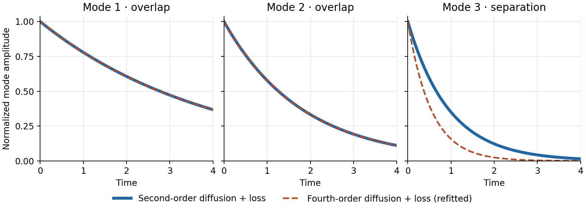
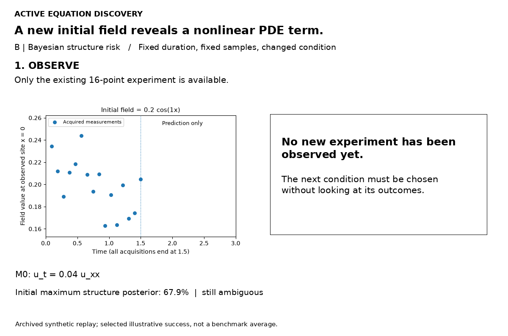

# Active Equation Discovery

[Motivation](#motivation) · [Method](#method) · [Results](#results) · [Reproduce](docs/REPRODUCE.md)

## Motivation

Scientific equation discovery aims to recover interpretable governing laws from observations. Methods such as SINDy can identify sparse dynamical equations that accurately explain measured trajectories. However, **a good fit does not guarantee that the underlying physical law is identifiable.**

### Why a second experiment can still be ambiguous

Consider two PDEs on a periodic domain.

$$
M_1:\quad u_t=D u_{xx}-ru,
\qquad
M_2:\quad u_t=-K u_{xxxx}-\ell u.
$$

Only the initial condition changes between experiments. **Each model must use one shared set of coefficients across all runs and spatial modes.** A mode initialized as $u(x,0)=\cos(kx)$ evolves as $u(x,t)=e^{-\lambda_k t}\cos(kx)$, with decay rates

$$
\lambda_k^{(1)}=Dk^2+r,
\qquad
\lambda_k^{(2)}=Kk^4+\ell.
$$

A first experiment with $k=1$ reveals one decay rate, even with perfect observations. A second experiment with $k=2$ reveals another, but the ambiguity can survive a joint refit. If $M_1$ generates the data, $M_2$ matches both rates exactly by choosing

$$
K=\frac{D}{5},
\qquad
\ell=r+\frac{4D}{5}.
$$

Initialize the second experiment with $u(x,0)=\cos(2x)+\cos(3x)$ to measure two independent decay rates in the same run. After matching modes 1 and 2, $M_2$ predicts a rate of $17D+r$ for mode 3, while $M_1$ predicts $9D+r$. The difference is $8D$, so the two runs distinguish the models whenever $D>0$. When $D=0$, both candidates can reduce to the same pointwise decay law.



*Illustration with $D=0.10$ and $r=0.15$. The fourth-order model is refitted jointly to modes 1 and 2, then evaluated on mode 3.*

## Method

**Sparse equation discovery → Experiment selection → New observations → Joint refitting**

1. **Fit candidate equations.** From the same predefined library, estimate the probability $p(S\mid D)$ of each term set $S$ given the noisy observations $D$. A term can be exactly zero. All experiments share the same physical coefficients.
2. **Score candidate experiments.** A condition $e$ changes the initial state or input. Both selectors use the same model and candidate experiments.

   - **D-optimality** maximizes the increase $\log\det(G_D+I_e)-\log\det G_D$, where $G_D$ is the current local information about the coefficients and $I_e$ is the estimated contribution from experiment $e$.
   - **Bayesian structure risk** maximizes the expected reduction in the probability of choosing the wrong term set. With $Y_e$ denoting the possible observations from experiment $e$,

     $$
     R(D)=1-\max_S p(S\mid D),\qquad
     U(e)=R(D)-\mathbb{E}_{Y_e\mid D}[R(D\cup\{e,Y_e\})].
     $$

3. **Measure and refit.** Add the new observations and update the term probabilities. For early stopping, report a structure at 95% posterior probability or mark it unresolved if the budget runs out.

### Worked example · Reaction–diffusion

At low amplitude the fit selects diffusion alone. The structure-risk selector chooses a higher-amplitude initial field, and refitting both runs adds the cubic reaction:

$$
\text{Initial fit: } u_t=0.04u_{xx},\qquad
\text{Updated fit: } u_t=0.04u_{xx}-0.3540u^3.
$$



One of eight observed sites is shown. Dots are observed samples through $t=1.5$. The dashed curve keeps the initial fit frozen. [Replay data](artifacts/allen_cahn_struct_risk_replay.json)

## Results

**4,224 tasks · 11 system families · 2 noise levels · up to 3 added experiments**

### Exact equation-structure recovery (%)

The table reports exact recovery of the optional term set after all three added experiments. The diffusion benchmark uses a library containing both diffusion terms. The Fourier example above compares two analytical candidates with separate loss terms.

| Case | Random | Fixed Design | D-optimal | Bayesian |
| --- | ---: | ---: | ---: | ---: |
| First-/second-order reaction | 92.19 | 95.57 | 96.09 | 95.57 |
| Co-reactant kinetics | 97.40 | 99.22 | 99.48 | 99.48 |
| Reversible reaction | 97.92 | 98.96 | 98.70 | 98.96 |
| Saturating kinetics | 91.93 | 97.40 | 97.66 | 97.66 |
| Nonlinear oscillator | 95.83 | 99.22 | 99.22 | 99.48 |
| Duffing oscillator | 93.75 | 99.74 | 99.74 | 99.74 |
| Forced nonlinear damping | 83.07 | 87.50 | 86.98 | 87.24 |
| Predator–prey coupling | 98.70 | 100 | 100 | 100 |
| Second-/fourth-order diffusion | 98.44 | 99.48 | 99.22 | 99.74 |
| Advection–diffusion | 100 | 100 | 100 | 100 |
| Nonlinear reaction–diffusion | 96.09 | 98.70 | 98.18 | 99.22 |
| **Overall** | **95.03** | **97.80** | **97.75** | **97.92** |

**Both adaptive selectors beat random.** Structure risk gained **0.12 percentage points** over optimized fixed (paired 95% interval **−0.19 to +0.40**), leaving the adaptive advantage over fixed unresolved. [Method and assumptions](docs/METHOD.md) · [Paired comparisons](benchmark/paired_comparisons.csv) · [Early stopping results](docs/RESULTS.md#early-stopping-is-a-different-endpoint)

## Run locally

```bash
python -m pip install -r requirements.txt
python run.py demo
python -X utf8 run.py check
```

[Full reproduction guide](docs/REPRODUCE.md) · [Data and code provenance](docs/PROVENANCE.md) · [Roadmap](docs/ROADMAP.md)
