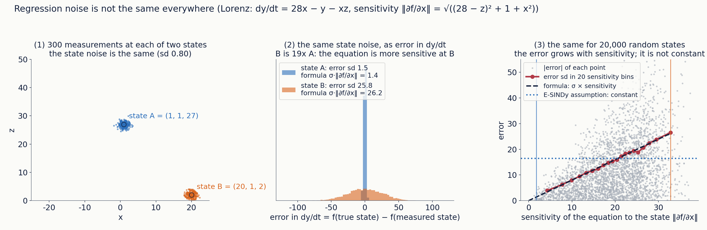
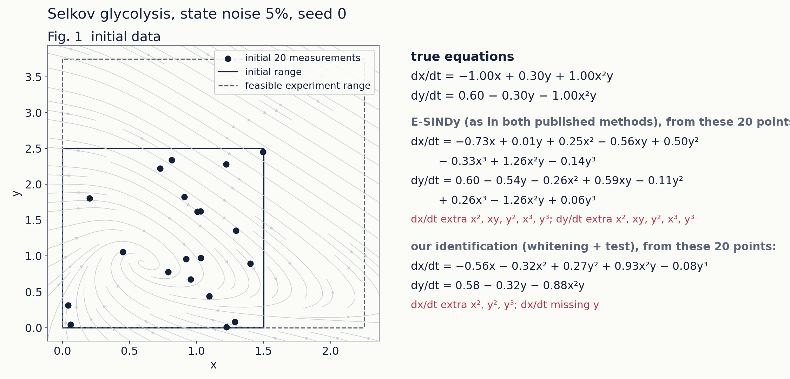
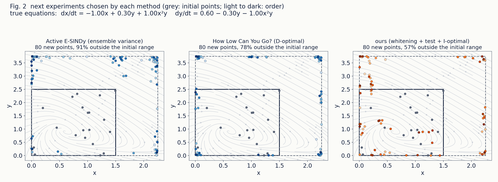
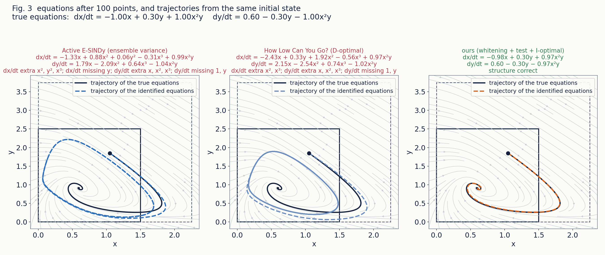
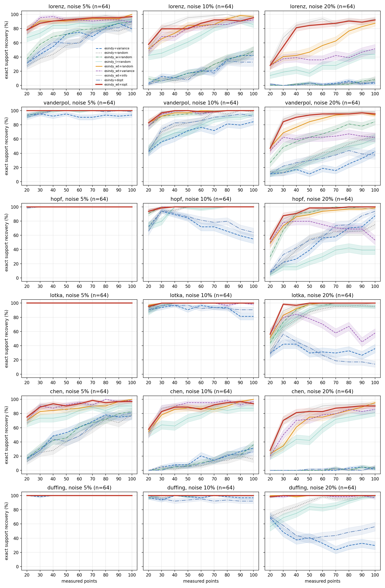

# Noise-aware active equation discovery

Given a few noisy measurements and the current SINDy result, which experiment should be run next so that the next equation is better?

This repository answers that with one noise model. The model fixes how the equation is identified and how the next experiment is chosen. It is compared, on the published protocols, against the two active methods it builds on:

- **Active E-SINDy** (Fasel et al. 2022): ensemble variance.
- ***How Low Can You Go?***: D-optimal design.

## The idea in one formula

A sparse-regression row is `r = b − a·ξ`. The features `a` and the target `b` are both computed from noisy measurements `m`. To first order:

```
Cov(r) = σ² J Jᵀ,      J = ∂r/∂m = ∂b/∂m − (∂a/∂m) ξ
```

So the regression noise is not constant. It depends on where the experiment was run and on the equation itself, and rows that share a measurement are correlated. E-SINDy and the acquisition scores built on it assume constant, independent noise.



An identified equation can be wrong in only two ways. Each part of the method fixes one of them:

| Error | Cause | Fix |
|---|---|---|
| **extra terms** | wrong standard errors, because the noise model is wrong, and a threshold that looks only at coefficient size | **identification**: whiten each experiment's rows with `σ²JJᵀ`, then keep a term only if its coefficient passes `λ` *and* `t² ≥ log n` (the BIC test, valid only after whitening) |
| **missing terms** | not enough information about that term | **acquisition**: choose the experiment that most reduces the model's average prediction variance over the feasible range (I-optimal), with candidate rows whitened by the same noise model |

No new hyperparameters are added. E-SINDy's bagging, `λ = 0.2` and inclusion thresholds stay unchanged, and `σ` cancels out. The algorithm never uses the true equation or a candidate's label. The full algorithm is in [docs/METHOD.md](docs/METHOD.md).

Settings are all special cases of the same formula:

| Setting | `J` | Acquisition |
|---|---|---|
| point observations (state noisy, derivative exact) | `−∇f(x)`, one row | I-optimal |
| trajectories (integral form) | ±1 at window ends minus quadrature weights × `∇f`; one trajectory is one correlated block | ensemble variance (see limits) |
| PDE (noise on `u_t` only) | constant, so weights are 1 | I-optimal |
| network dynamics (graph known) | 10×10 per snapshot, sparse along the edges | I-optimal |

## One run, step by step

The run uses Selkov glycolysis at 5% state noise. Twenty initial points come from a limited range, and later experiments may leave it.





## Results

The metric is exact-support recovery averaged over the whole acquisition curve, then over seeds (32–64 per configuration). "Better / tie / worse" is the paired difference over seeds, beyond 2 standard errors.

- **Bayesian SINDy + active** is sparse Bayesian learning (Zhang & Lin 2018) with our I-optimal acquisition added. It is the strongest literature identifier we found. Weak SINDy and Modified SINDy were also re-implemented and given active selection; see [docs/RESULTS.md](docs/RESULTS.md).
- Random sampling is a reference only, not a competitor.

| Setting | Configs | vs Active E-SINDy | vs D-optimal | vs Bayesian SINDy + active | Mean: ours / best competitor |
|---|---|---|---|---|---|
| point observations, 6 ODEs × 5/10/20% | 18 | 15 / 3 / 0 | 15 / 3 / 0 | 12 / 5 / 1 | **93.4** / 71.4 |
| biology, chemistry, materials, 11 models × 5/10% | 22 | 16 / 5 / 1 | 18 / 3 / 1 | 8 / 8 / 6 | **63.4** / 62.8 |
| **experiments may leave the initial range**, 17 models | 34 | 31 / 3 / 0 | 31 / 3 / 0 | 24 / 6 / 4 | **86.3** / 59.8 |
| trajectories, 4 ODEs × 5/10% | 8 | 8 / 0 / 0 | – | 6 / 2 / 0 | **60.7** / 47.0 |
| PDE (Burgers, Kuramoto–Sivashinsky) × 50/100% | 4 | 4 / 0 / 0 | 4 / 0 / 0 | 1 / 1 / 2 | 62.7 / **72.6** |
| network dynamics (SIS, bistable, competition) × 5/10/20% | 9 | 8 / 1 / 0 | 8 / 1 / 0 | 6 / 2 / 1 | **79.1** / 62.1 |

Per-configuration tables come from `python src/report.py` and are collected in [docs/RESULTS.md](docs/RESULTS.md).



### Where it does not win

- **Collinear libraries.** The "threshold + test" selection is weaker than ARD (Bayesian SINDy) when library columns are nearly parallel. Examples are the Hill toggle switch, Selkov at 10% on its original range, and SIS at 20% on a graph, where column correlations are 0.95–0.99. ARD is weaker on high-noise polynomial systems (Lorenz 20%: 19 vs 77). We tried to unify the two and failed. Every unified variant lost badly on one side.
- **PDE with target-only noise.** Whitening does nothing there, and ARD wins on Burgers.
- **Trajectories.** I-optimal must predict which states a candidate initial condition will visit, using the current, possibly wrong, model. It trails ensemble variance by 3–11 points. With the true model's prediction it catches up, so the trajectory setting keeps ensemble variance and only the identification changes.
- **Acquisition gain over random on graphs is small** (+1.6 on average). Random network states already cover the space evenly, so most of the gain there comes from identification.
- **Information limits.** On the original range, Arrhenius cannot be identified by any sampling: a c-optimal bound needs over 10⁴ points. Allowing experiments outside the range helps, but only partly (Arrhenius 10%: 7.6%).

## Reproduce

Python 3.10+:

```bash
pip install -r requirements.txt
```

```bash
python src/report.py
```

Each experiment below writes `results/<setting>.json`. Pass `-` for any argument to keep its default.

```bash
python src/experiments.py points 64
```

```bash
python src/experiments.py traj 64
```

```bash
python src/experiments.py pde 64 - 0.5,1
```

```bash
python src/domains.py 32
```

```bash
python src/expand.py 32
```

```bash
python src/graphs.py 32
```

Checks run in CI. They confirm noise-free identifiability of every model, and that measured residual noise matches the formula:

```bash
python src/domains.py check
```

```bash
python src/graphs.py check
```

Figures:

```bash
python src/plot.py results/points.json
```

```bash
python src/noise_explain.py
```

```bash
python src/process_fig.py selkov 0.05 0
```

## Repository layout

| Path | Contents |
|---|---|
| `src/noise_aware.py` | the method: libraries, noise model and whitening (`whiten`), E-SINDy with the significance test (`stlsq`, `esindy`, `identify`), acquisition scores (`prediction_score` = ours, `variance_score`, `dopt_score`) |
| `src/experiments.py` | point, trajectory and PDE protocols; the trial loop `run_trial` |
| `src/domains.py` | general function library; 11 biology, chemistry and materials models |
| `src/expand.py` | protocol where experiments may leave the initial range |
| `src/graphs.py` | network-dynamics protocol: graph library with exact gradients, snapshot experiments |
| `src/baselines.py` | Weak SINDy, Bayesian SINDy (SBL) and Modified SINDy, re-implemented from the papers |
| `src/compare_pretrained.py` | passive comparison with the pretrained ODEFormer |
| `src/report.py`, `src/plot.py`, `src/noise_explain.py`, `src/process_fig.py` | tables and figures |
| `results/` | raw results (`*.json`) and printed summaries (`*.txt`) |
| `docs/METHOD.md` | full algorithm, hyperparameters, every protocol |
| `docs/RESULTS.md` | all tables, diagnostics and approaches that were tried and dropped |

## References

- U. Fasel, J. N. Kutz, B. W. Brunton, S. L. Brunton. Ensemble-SINDy. *Proc. R. Soc. A* 478 (2022).
- *How Low Can You Go?* Active learning for sparse equation discovery (D-optimal design). No code was released, so unspecified settings follow the Active E-SINDy code.
- G. E. P. Box, N. R. Draper. A basis for the selection of a response surface design. *JASA* 54 (1959): the I-optimal criterion.
- D. A. Messenger, D. M. Bortz. Weak SINDy. *Multiscale Model. Simul.* 19 (2021).
- S. Zhang, G. Lin. Robust data-driven discovery of governing physical laws with error bars. *Proc. R. Soc. A* 474 (2018).
- K. Kaheman, S. L. Brunton, J. N. Kutz. Automatic differentiation to simultaneously identify nonlinear dynamics and extract noise probability distributions. *Mach. Learn.: Sci. Technol.* 3 (2022).
- S. d'Ascoli et al. ODEFormer. *ICLR* (2024).

This is a research prototype on synthetic benchmarks, not a peer-reviewed result.
