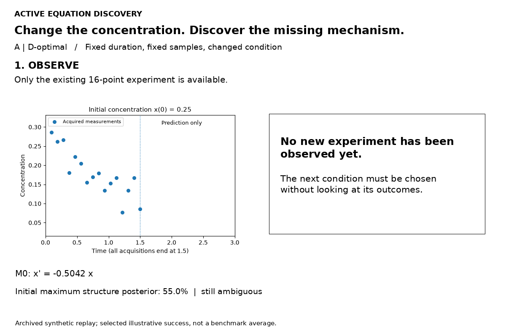
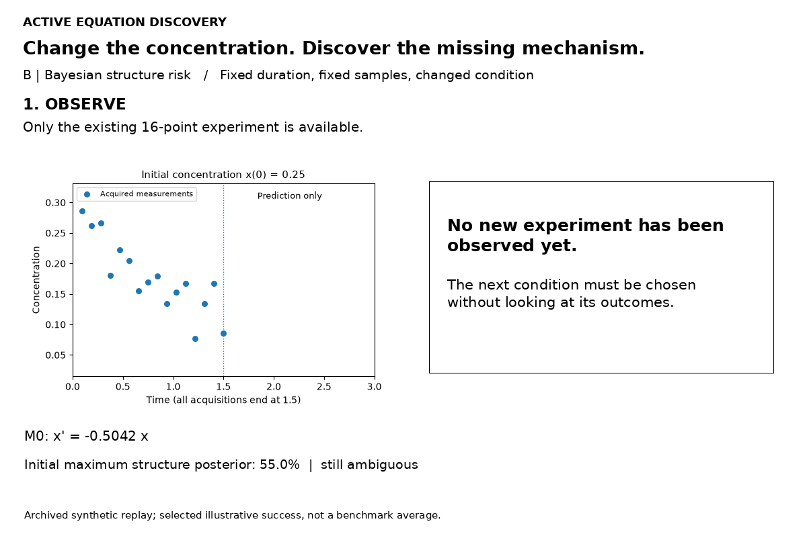
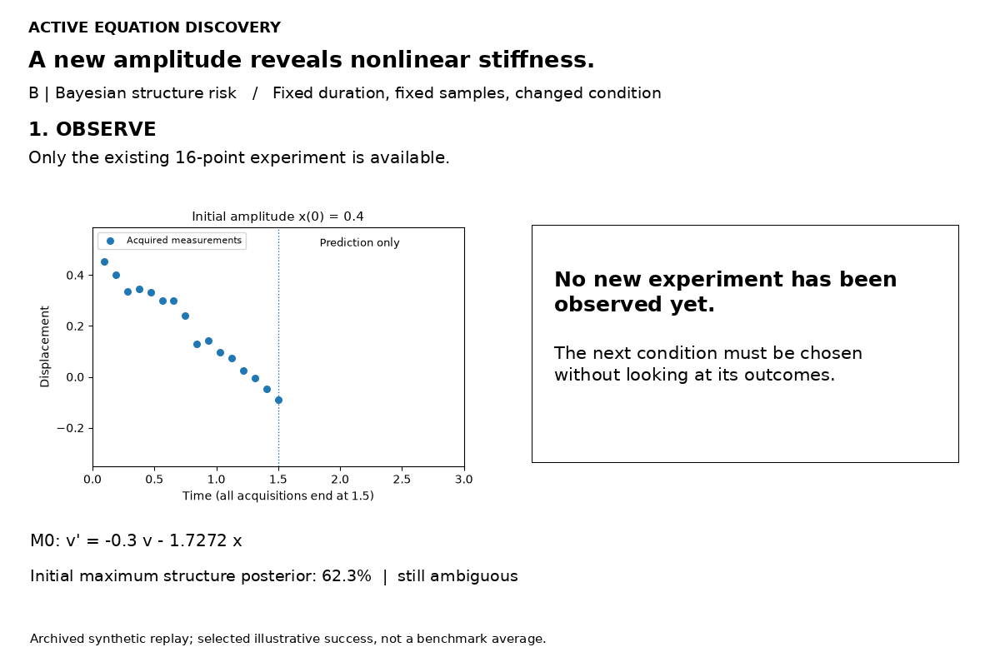

# Active Equation Discovery

## Motivation

Scientific equation discovery aims to recover interpretable governing laws from observations. Methods such as SINDy can identify sparse dynamical equations that accurately explain measured trajectories. However, **a good fit does not guarantee that the underlying physical law is identifiable.**

### Two equations can fit the same experiments

Consider second- and fourth-order diffusion on a periodic domain, each with an unknown linear loss term.

$$
M_1:\quad u_t=D u_{xx}-ru,
\qquad
M_2:\quad u_t=-K u_{xxxx}-\ell u.
$$

Only the initial condition changes. **Each model uses one shared coefficient pair across all runs and modes.** For $u(x,0)=\cos(kx)$, the mode evolves as $u(x,t)=e^{-\lambda_k t}\cos(kx)$. The two decay rates are

$$
\lambda_k^{(1)}=Dk^2+r,
\qquad
\lambda_k^{(2)}=Kk^4+\ell.
$$

**Two modes give two constraints.** The first run excites mode 1 and reveals one decay rate. If the second run excites only mode 2, its rate provides a second constraint. The fourth-order model can match both rates from the second-order model exactly by fitting its two unknown coefficients.

$$
K=\frac{D}{5},
\qquad
\ell=r+\frac{4D}{5}.
$$

**The third mode tests the fit.** Excite modes 2 and 3 together in the second run with $u(x,0)=\cos(2x)+\cos(3x)$. The two modes evolve independently, so we get three rates in just two runs. Matching modes 1 and 2 already fixes both coefficients of the fourth-order model. Its mode-3 rate is $17D+r$, while the second-order model gives $9D+r$. The gap of $8D$ distinguishes the models in noiseless data when $D>0$. At $D=0$, both can describe the same pure decay.


The dashed curve uses the same refitted coefficients in all three panels. The second-order model uses $D=0.10$ and $r=0.15$.

**Can a partially identified equation guide its next experiment?** The challenge is to design informative experiments even when the currently selected equation is incorrect. We use the candidate structures still supported by the data to predict which experimental conditions could distinguish them.

## Method

**Does an experiment that improves coefficient estimates also help identify the correct equation?** We compare two established design criteria in the same discovery loop. A condition can sharpen estimates within a candidate equation while leaving its alternatives plausible.

**1. Fit several structures.** Start with a predefined library of terms. Fit model trajectories to the noisy observations $\mathcal D$ to estimate the posterior probability $p(S\mid\mathcal D)$ of each active term set $S$. Within each structure, coefficients are shared across runs.

**2. Choose the next condition.** Both selectors score the same menu of initial conditions or inputs before seeing any new measurements.

- **D-optimal · parameter information.** Pick the condition with the largest gain in local coefficient information, $\log\det(G+I_e)-\log\det G$. Here $G$ is the current information matrix and $I_e$ is estimated from trajectory sensitivities under condition $e$.
- **Bayesian · structure discrimination.** Pick the condition with the largest expected drop in the probability of choosing the wrong term set. Average over candidate structures, their coefficients and the noisy measurements $Y_e$ they predict.

$$
\begin{aligned}
R(\mathcal D)&=1-\max_S p(S\mid\mathcal D),\\
U(e)&=R(\mathcal D)-\mathbb E_{Y_e\mid\mathcal D,e}\big[R(\mathcal D\cup\{(e,Y_e)\})\big].
\end{aligned}
$$

**3. Measure and refit.** Add the selected run and update the posterior using all runs. In the early-stopping evaluation, declare a structure once its posterior reaches 95%, or report the task as unresolved at the budget limit. [Method details](docs/METHOD.md)

### Two selectors on the same reaction

Both replays start from the same noisy, low-concentration measurements. Both selectors choose the same higher initial concentration (from 0.25 to 2.0), where the new observations support saturating kinetics. The scores in the two animations measure different quantities. [D-optimal replay data](artifacts/enzyme_d_opt_replay.json) · [Bayesian replay data](artifacts/enzyme_struct_risk_replay.json)

**D-optimal**



**Bayesian structure risk**



<details>
<summary>More replays: reaction–diffusion and Duffing oscillator</summary>

**Reaction–diffusion.** Increasing the initial amplitude at the same spatial frequency reveals a cubic reaction term. [Replay data](artifacts/allen_cahn_struct_risk_replay.json)


**Duffing oscillator.** A different initial amplitude reveals nonlinear stiffness. [Replay data](artifacts/duffing_struct_risk_replay.json)



</details>

## Results

The benchmark covers **4,224 synthetic tasks across 11 ODE and PDE families at two noise levels**. Each family has a predefined library with **two optional mechanisms**, yielding four candidate term sets. In 35.9% of tasks neither optional mechanism is present. All policies share the initial run and add three runs. Fixed Design uses a schedule optimized in advance.

### Exact equation-structure recovery (%)

Recovery means selecting exactly the optional terms in the generating equation at the end of the three-run budget. The diffusion benchmark tests a library containing both diffusion orders. The Fourier derivation above is a separate illustration.

| Case | Random | Fixed Design | D-optimal | Bayesian |
| --- | ---: | ---: | ---: | ---: |
| First-/second-order reaction | 92.19 | 95.57 | 96.09 | 95.57 |
| Co-reactant kinetics | 97.40 | 99.22 | 99.48 | 99.48 |
| Reversible reaction | 97.92 | 98.96 | 98.70 | 98.96 |
| Saturating kinetics | 91.93 | 97.40 | 97.66 | 97.66 |
| Nonlinear oscillator | 95.83 | 99.22 | 99.22 | 99.48 |
| Duffing oscillator | 93.75 | 99.74 | 99.74 | 99.74 |
| Forced nonlinear damping | 83.07 | 87.50 | 86.98 | 87.24 |
| Predator–prey coupling | 98.70 | 100 | 100 | 100 |
| Second-/fourth-order diffusion | 98.44 | 99.48 | 99.22 | 99.74 |
| Advection–diffusion | 100 | 100 | 100 | 100 |
| Nonlinear reaction–diffusion | 96.09 | 98.70 | 98.18 | 99.22 |
| **Overall** | **95.03** | **97.80** | **97.75** | **97.92** |
| At least one optional term (2,709 tasks) | 92.62 | 96.60 | 96.53 | 96.75 |

**Both adaptive selectors improved on random selection.** Bayesian structure risk gained **2.89 percentage points** over random (paired 95% interval **+2.30 to +3.55**), **0.12 points** over Fixed Design (**−0.19 to +0.40**), and **0.17 points** over D-optimal (**−0.17 to +0.50**). The latter two intervals leave the ranking among these three designs unresolved. [Paired comparisons](benchmark/paired_comparisons.csv) · [Early stopping and benchmark limits](docs/RESULTS.md#early-stopping-is-a-different-endpoint)

## Reproduce and extend

```bash
python -m pip install -r requirements.txt
python run.py demo
python -X utf8 run.py check
```

Next steps are larger libraries of competing mechanisms and learning correlated or nonconstant measurement noise. [Reproduction guide](docs/REPRODUCE.md) · [Provenance](docs/PROVENANCE.md) · [Roadmap](docs/ROADMAP.md)
