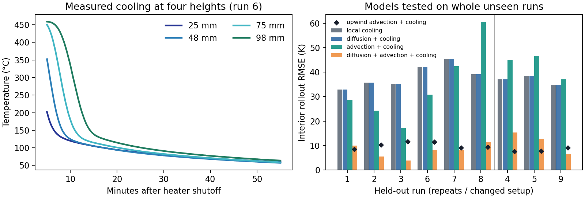
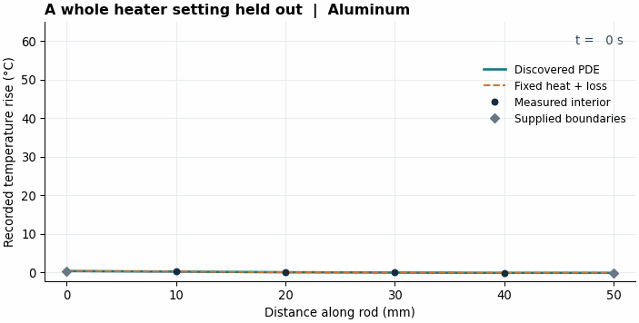
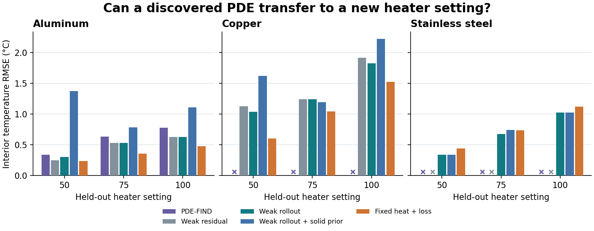

# PDE discovery from measured heat transfer

## Case 1 · Air cooling a packed bed

Can a model fitted on previous runs predict temperatures inside a porous bed on a new run? On nine experiments from DLR and RWTH Aachen, advection-based models reduce interior rollout error. With an upwind discretization, fitted explicit diffusion drops to zero in all nine folds. [Case study and reproduction](PACKED_BED_PDE.md)



## Case 2 · Heat conduction in metal rods

**Can an equation learned from two heater settings predict the inside of a metal rod at a third?** We test on 27 wind-tunnel experiments with six thermocouples each, spanning aluminum, copper, and stainless steel. The solver sees the initial profile and both measured end temperatures. The four interior temperature histories are held out. [Experimental data and attribution](data/README.md)



## Method

1. Check the raw CSV hashes and interpolate each run onto a 0.5 s grid for its first 240 s.
2. Search a common candidate library of diffusion, axial drift, linear loss or growth, and a constant. The strong-form PDE-FIND baseline builds a sequential thresholded ridge path. The weak regression integrates against localized space–time test functions and enumerates the 15 nonempty term sets.
3. Hold out one heater setting per material. Fit on repeats 1 and 2 of the two available settings and select structure on their repeat 3. Compare residual-based selection with ranking by validation rollouts that pass a nonnegative-diffusion and discrete spectral stability check. A solid-rod prior further requires positive diffusion, excludes axial drift, and constrains linear heat loss to be dissipative.
4. Test on all three repeats of the unseen heater setting. Fit a fixed heat-plus-loss control directly against all six available training and validation trajectories. A straight line between the measured ends supplies a boundary-only control.

The baselines use adaptations of [PDE-FIND](https://doi.org/10.1126/sciadv.1602614) and [weak-form sparse PDE discovery](https://doi.org/10.1016/j.jcp.2021.110525). The method is sized for a six-sensor grid and a four-term library.

## Results

| Method | Test RMSE over usable folds | Folds passing the rollout check |
|---|---:|---:|
| PDE-FIND | 0.614 °C | 3/9 |
| Weak residual | 1.096 °C | 6/9 |
| Weak rollout | 0.962 °C | 9/9 |
| Weak rollout + solid prior | 1.266 °C | 9/9 |
| Fixed heat + loss | **0.828 °C** | 9/9 |
| Linear boundary | 12.268 °C | 9/9, algebraic |



Crosses mark rejected equations. PDE-FIND estimated negative diffusion in all six copper and steel folds. Weak rollout returned stable equations in all nine folds and selected an axial drift term in seven. The published solid-rod model describes axial diffusion with surface cooling. Lower interior RMSE alone gives limited evidence about which terms represent that mechanism. The fixed heat-plus-loss control has the lowest pooled error among methods usable on all nine folds. The weak rollout improves over that control on steel alone, from 0.813 to 0.735 °C.

**Known-equation checks.** Diffusion, diffusion with loss, and drift–diffusion are simulated on a 21-point grid and sampled at six positions. Weak rollout recovers the exact term set in 15/15 trials at 0.25 °C measurement noise, versus 14/15 for weak residual and 13/15 for PDE-FIND. The same weak method recovers 0/3 noiseless term sets. Fine-to-coarse discretization error remains at zero noise, and these small trials do not establish a noise-robustness advantage. Real-data support is unlabelled. [Per-fold and synthetic results](results/benchmark.json)

## Reproduce

Run with Python 3.12 from the repository root. The attributed input logs are bundled for offline benchmark execution.

```bash
python -m pip install -r requirements.txt
python benchmark.py
python figures.py
```

This public case demonstrates the preprocessing, symbolic candidate generation, and campaign-level validation workflow described in the [Lila Sciences equation-discovery role](https://job-boards.greenhouse.io/lilasciences/jobs/4469152009). The thermal measurements come from Tomanek and Stutts at Missouri S&T.
