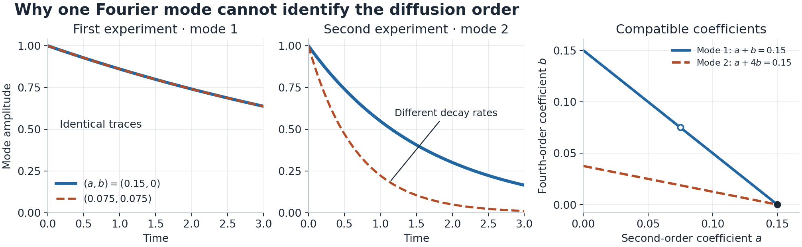
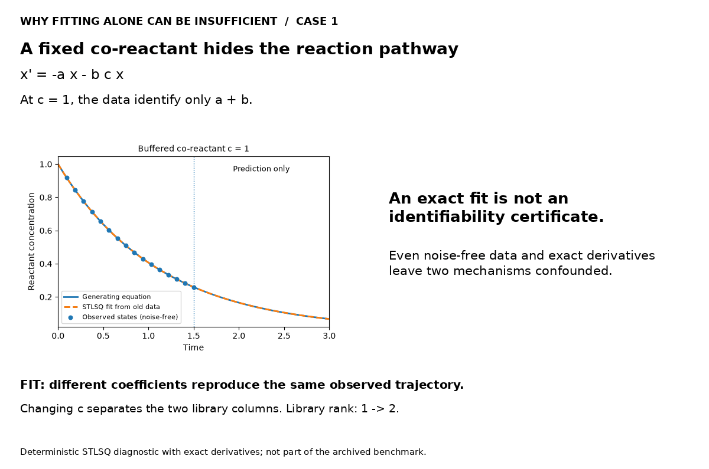

# Active Equation Discovery

Fit several candidate equations to the data, choose an experiment that helps tell them apart, then refit on all acquired runs. The benchmark compares two ways to choose that next experiment on synthetic ODEs and PDEs.

[Method](docs/METHOD.md) · [Results](docs/RESULTS.md) · [Reproduce](docs/REPRODUCE.md)

## A PDE in one experiment loop

At low amplitude, diffusion alone fits the observations. The next experiment starts at higher amplitude, where the cubic reaction becomes visible.


One of eight observed sites is shown. Measurements end at $t=1.5$. [Replay data](artifacts/allen_cahn_struct_risk_replay.json)

## Why the next experiment matters

For $u_t=a u_{xx}-b u_{xxxx}$, the amplitude of a Fourier mode with wavenumber $k$ decays at rate

$$
\lambda_k=ak^2+bk^4.
$$

Mode 1 reveals only $a+b$. Mode 2 independently reveals $a+4b$ from its decay rate divided by four. The two measurements identify both coefficients in this noiseless example.



[Diffusion, reaction and oscillator controls](docs/FAILURE_CASES.md#one-spatial-mode-hides-the-diffusion-order)

## How the method chooses an experiment

1. **Fit candidate equations.** From the same predefined library, estimate the probability $p(S\mid D)$ of each term set $S$ given the noisy observations $D$. A term can be exactly zero. All experiments share the same physical coefficients.
2. **Score candidate experiments.** A condition $e$ changes the initial state or input. Both selectors use the same model and candidate experiments.

   - **D-optimality** maximizes the increase $\log\det(G_D+I_e)-\log\det G_D$, where $G_D$ is the current local information about the coefficients and $I_e$ is the estimated contribution from experiment $e$.
   - **Bayesian structure risk** maximizes the expected reduction in the probability of choosing the wrong term set. With $Y_e$ denoting the possible observations from experiment $e$,

     $$
     R(D)=1-\max_S p(S\mid D),\qquad
     U(e)=R(D)-\mathbb{E}_{Y_e\mid D}[R(D\cup\{e,Y_e\})].
     $$

3. **Measure and refit.** Add the new observations and update the term probabilities. For early stopping, report a structure at 95% posterior probability or mark it unresolved if the budget runs out.

## Benchmark

**4,224 tasks · 11 system families · 2 noise levels · up to 3 added experiments**

### Exact equation-structure recovery (%)

| Case | Random | Fixed Design | D-optimal | Bayesian |
| --- | ---: | ---: | ---: | ---: |
| First-/second-order reaction | 92.19 | 95.57 | 96.09 | 95.57 |
| Co-reactant kinetics | 97.40 | 99.22 | 99.48 | 99.48 |
| Reversible reaction | 97.92 | 98.96 | 98.70 | 98.96 |
| Saturating kinetics | 91.93 | 97.40 | 97.66 | 97.66 |
| Nonlinear oscillator | 95.83 | 99.22 | 99.22 | 99.48 |
| Duffing oscillator | 93.75 | 99.74 | 99.74 | 99.74 |
| Forced nonlinear damping | 83.07 | 87.50 | 86.98 | 87.24 |
| Predator–prey coupling | 98.70 | 100 | 100 | 100 |
| Second-/fourth-order diffusion | 98.44 | 99.48 | 99.22 | 99.74 |
| Advection–diffusion | 100 | 100 | 100 | 100 |
| Nonlinear reaction–diffusion | 96.09 | 98.70 | 98.18 | 99.22 |
| **Overall** | **95.03** | **97.80** | **97.75** | **97.92** |

**Both adaptive selectors beat random.** Structure risk gained **0.12 percentage points** over optimized fixed (paired 95% interval **−0.19 to +0.40**), leaving the adaptive advantage over fixed unresolved. [Method and assumptions](docs/METHOD.md) · [Paired comparisons](benchmark/paired_comparisons.csv) · [Early stopping results](docs/RESULTS.md#early-stopping-is-a-different-endpoint)

<details>
<summary>More experiment replays</summary>



**Reaction kinetics**


**Nonlinear stiffness**


</details>

## Run locally

```bash
python -m pip install -r requirements.txt
python run.py demo
python -X utf8 run.py check
```

[Full reproduction guide](docs/REPRODUCE.md) · [Data and code provenance](docs/PROVENANCE.md) · [Roadmap](docs/ROADMAP.md)
