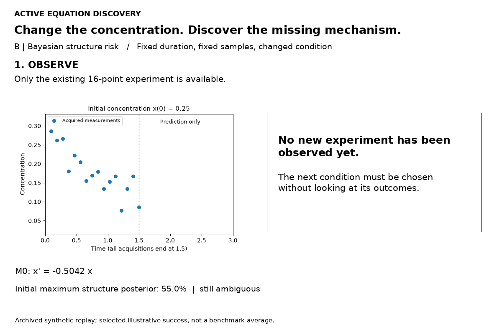
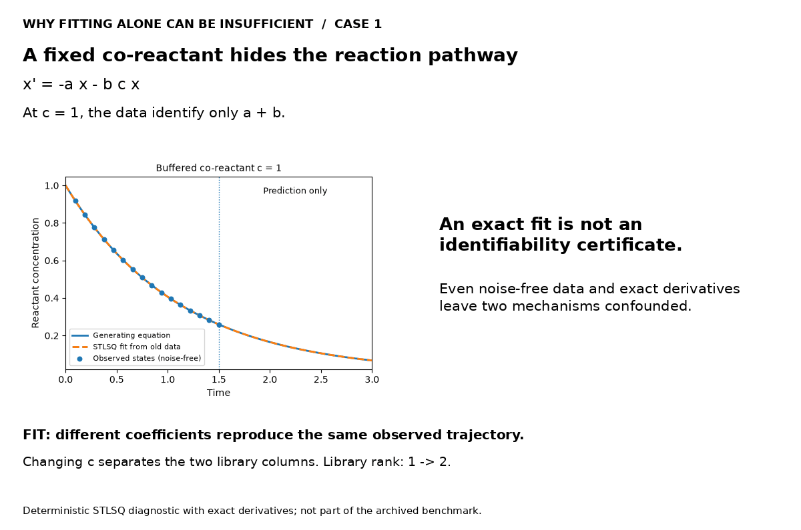
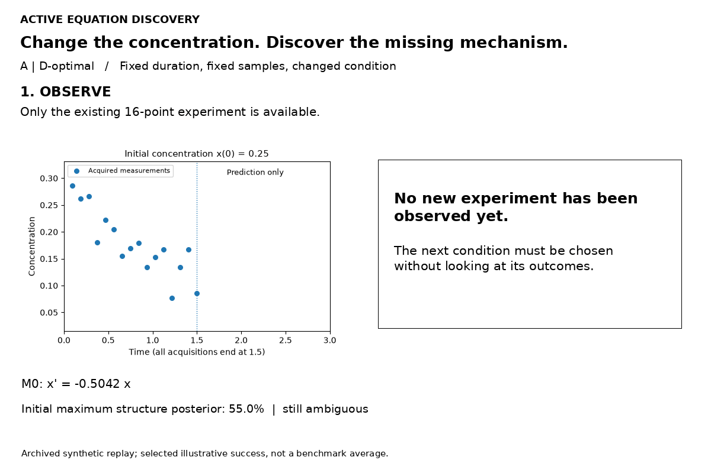
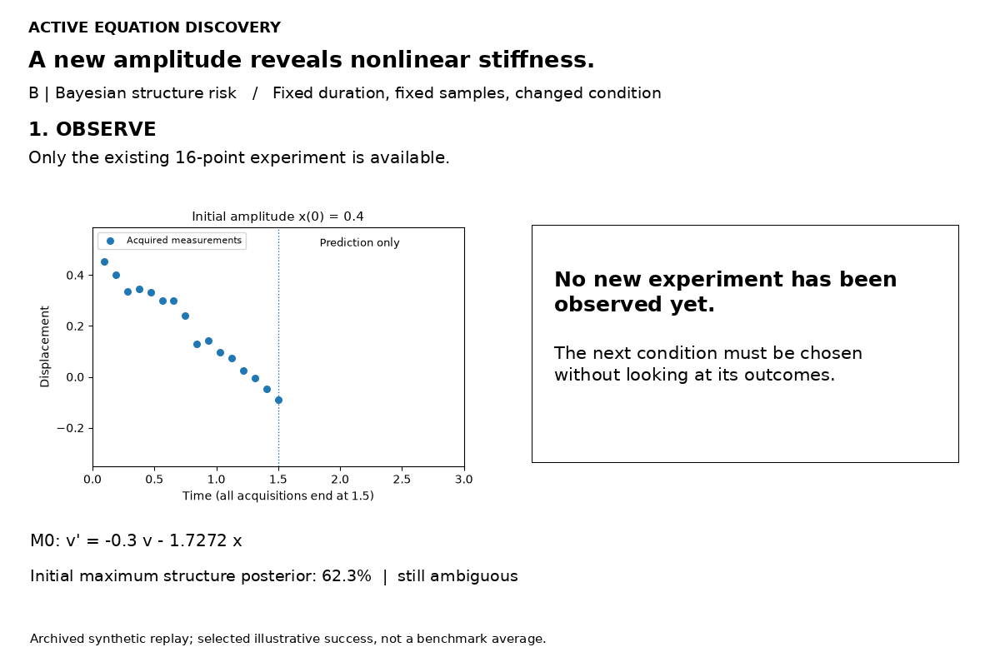
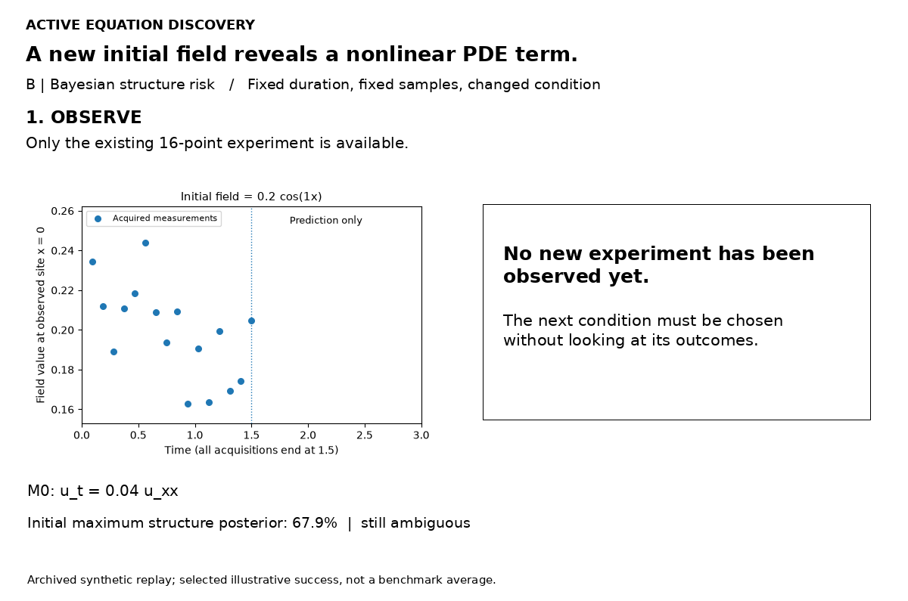
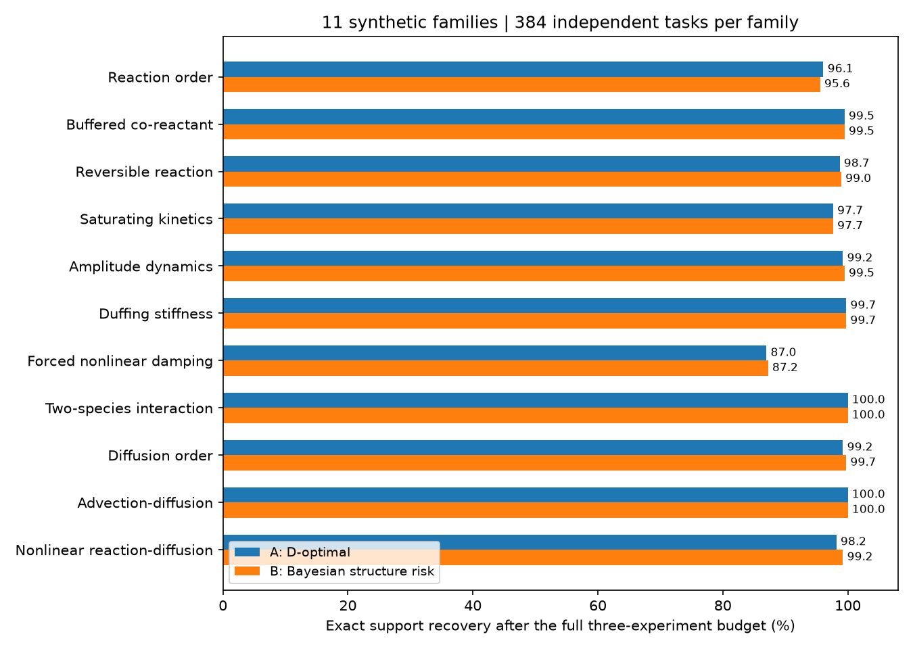

# 主动方程发现

### 多条方程都能拟合时，改变实验，而不只是继续拟合。

**当前方程还没有辨识清楚，能不能让它指导下一次实验，再利用新数据纠正自己？** 这个项目把这条闭环做成可以复现的代码与动图。

[English](README.md) · [方法](docs/METHOD.md) · [结果与边界](docs/RESULTS.md) · [复现](docs/REPRODUCE.md)

> 当前是合成实验研究原型：比较两个已有的实验选择原则，共用一个贝叶斯稀疏函数库辨识器。不宣称新的 SINDy 算法、普遍最优或真实实验室验证。

## Motivation：拟合好，不等于机制已经确定

考虑反应方程：

$$\dot x=-ax-bcx.$$

$c$ 是一轮实验内保持不变的共反应物浓度。如果所有实验都取 $c=1$，只能识别 $a+b$。直接反应、共反应物参与的反应，以及二者混合，都能产生相同轨迹。**在同一个条件下观察更久，仍然分不清。**

把 $c$ 改变，就产生了新的独立约束。现在同一组物理系数必须同时解释两个实验。我们想做的不是让曲线更贴点，而是：

> **让当前仍然合理的方程，指导一个能区分它们的新实验。**

## 全过程：现有点 → 拟合 → 选实验 → 新点 → 再拟合 → 停止



散点是真实生成并归档的**合成测量**；虚线是冻结系数的旧方程；实线是更新后的预测。每次实验都只有 **16个观测时刻，时长固定为1.5**。为了看清外推，全部曲线画到3，但1.5之后明确标为**仅预测、没有观测**。更新后，旧实验和旧曲线都保留。

这是预先声明规则选出的成功说明案例，不是平均性能，也不是新增的独立评估样本；发布时按原始种子重建。[数据来源](artifacts/enzyme_struct_risk_replay.json)。

## 三个 SINDy 被动辨识的失败模式

这里采用透明的 STLSQ（顺序阈值最小二乘）实现。故意提供无噪声状态和精确导数：即使排除了求导误差，信息不足仍然存在。它们不是官方 PySINDy 的直接运行，也不混入主实验正确率。

| 场景 | 为什么已有数据分不清？ | 什么干预有帮助？ |
|---|---|---|
| 反应路径 | 固定共反应物浓度时，$x$ 和 $cx$ 两列相同 | 改变共反应物浓度 |
| 扩散阶数 | 单一空间模态上，二阶与四阶导数成比例 | 改变空间激励 |
| 振子恢复 | 只观察极限环，增长与饱和项恰好抵消 | 从环外起始 |



[反应图](assets/failure_co_reactant.png) · [PDE图](assets/failure_pde_mode.png) · [振子图](assets/failure_limit_cycle.png) · [方程与核验](docs/FAILURE_CASES.md)

**这不是说 SINDy 普遍不可靠，而是“回归选出一个答案”不能代替“实验排除了其他答案”。**

## 两个方案，共用同一发现流程

**A：D-optimal。** 预测不同实验的可观测轨迹敏感度，选择最能补充独立参数信息的条件。当前系数为零的候选项也参与评分。

**B：贝叶斯结构风险。** 同时保留方程项是否存在、系数是多少的不确定性，选择预计最能降低“选错结构”概率的条件。

两者共用候选库、先验、观测似然、实验菜单和停止规则。这里的主辨识器是 **Bayesian SINDy-style 稀疏函数库方法**，而非未修改的 PySINDy/STLSQ 或完整复现 UQ-SINDy。主测试每类只有两个可选机制。

<details>
<summary><strong>展开查看 D-optimal 的全过程</strong></summary>



在这个例子里，两种方案选中了同一条件；两个评分含义不同，不直接比较数值大小。

</details>

<details>
<summary><strong>展开查看振子与非线性 PDE 的回放</strong></summary>





PDE画面显示一个观测位置；辨识使用全部八个观测位置。均为归档合成实验。

</details>

## 结果：两个方案都有效，没有普遍赢家

主测试 **4,224个独立任务**：11类动力学 × 2个噪声水平 × 每组192个。一次共同初始实验，最多新增三次；每次时长和观测数量相同。

| 选择器 | 做满三次后的完整结构恢复率 | 共同停止规则下平均新增次数 |
|---|---:|---:|
| 随机改变条件 | 95.03% | 1.435 |
| 先验模拟优化的固定设计 | 97.80% | 1.023 |
| **A：D-optimal** | **97.75%** | **1.035** |
| **B：贝叶斯结构风险** | **97.92%** | **1.004** |

两列来自不同终点，不能据此宣称提前停止完全无损。B−A 的差值为 **+0.17个百分点，配对95%区间 −0.17～+0.50**，没有建立普遍优势。固定设计同样很强。



共同停止规则：最大结构后验达到95%就停止，否则继续到预算上限并保留“未解决”。A、B的未解决比例分别是7.60%、6.39%。后验判断以候选库、先验和误差模型成立为条件，不是任意真值下的95%保证。[完整结果](docs/RESULTS.md)。

## 运行

Python 3.12/3.13；demo无需GPU、账户或外部数据下载。

```bash
python -m pip install -r requirements.txt
python run.py check
python run.py demo
python run.py figures
python run.py summary
```

[完整复现说明](docs/REPRODUCE.md)。动图可从归档记录重新生成；demo会实际运行两个选择器，而不是只播放图片。

## 边界与 Future Work

当前仅是小候选库、已知初态和部分物理先验下的合成验证；噪声与参数先验主要匹配真值。部分投影、符号和基础机制已知；非线性PDE网格较小。匹配了采集次数、时长和采样量，没有匹配真实试剂、能量和准备成本。

未来重点放在：

- **三项以上竞争机制：** 更大的稀疏词库、相邻机制相互补偿、候选结构的保留与排除。
- **可信噪声模型：** 学习相关及异方差误差，检查库外物理，避免自适应停止后的虚假高置信度。

已有试探性结果保留在归档中，不把这两件事写成已经解决。真实实验、官方PySINDy/PDE-FIND/PySR对照也属于后续验证。[路线图](docs/ROADMAP.md)。

## 参考与来源

SINDy、Active E-SINDy、贝叶斯稀疏先验和最优实验设计都是已有工作。参考文献见[英文首页](README.md#references)与[方法说明](docs/METHOD.md)。本项目的价值在于清楚、可检查地展示“方程如何反过来指导实验”，不在于给已有准则换名称。[来源与审计](docs/PROVENANCE.md)。
