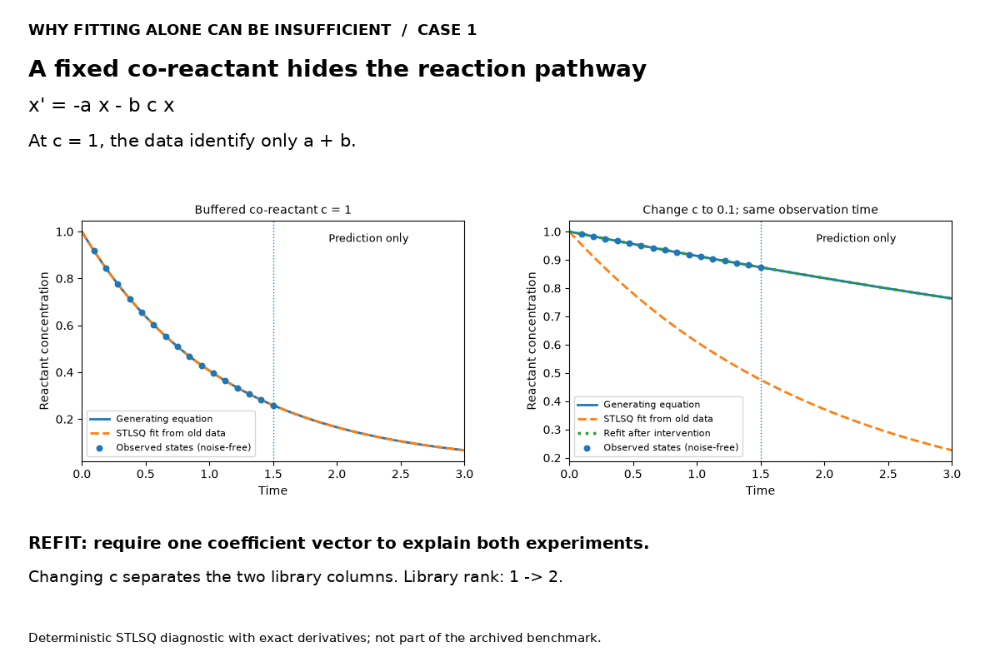
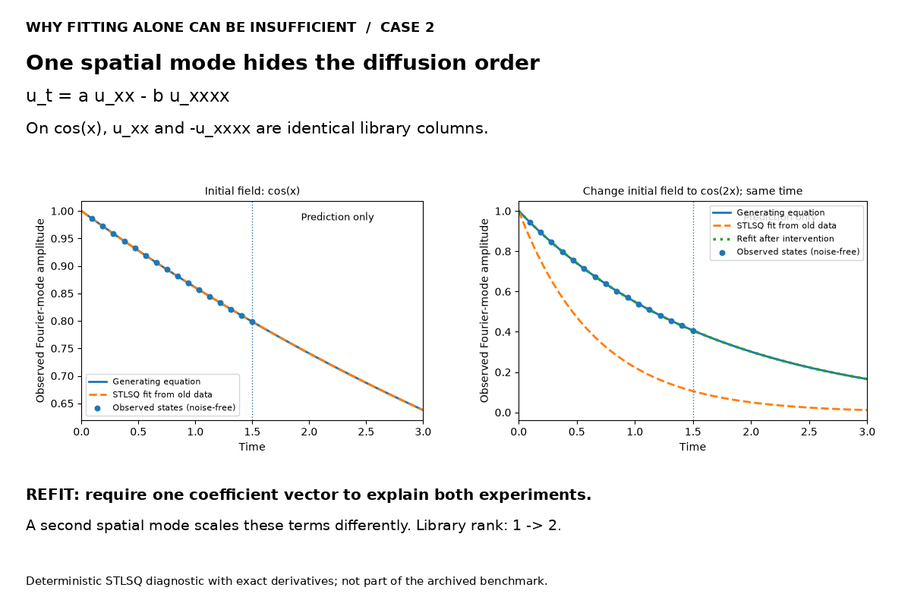
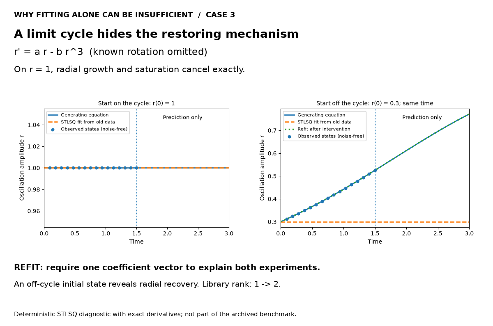

# Passive fitting can be non-identifiable

These figures are deliberately simple counterexamples. The algorithm receives a chosen dictionary and exact derivatives of noise-free states. That removes differentiation errors and shows an information limit. A different sparse optimizer may return a different equally good answer; it cannot prove uniqueness from a rank-deficient experiment.

The implementation is a transparent unregularized **STLSQ** loop with threshold 0.05 and at most 20 iterations, in `scripts/prepare_visual_data.py`. It is not the official PySINDy package. No parameters were tuned on a noisy benchmark to make a competitor look worse. The main Bayesian benchmark does not use these derivative labels.

Each old condition has rank 1 in a two-column library. Adding the new condition gives rank 2. Both state data and the derivative labels satisfy the declared generating equation exactly. Curves extend to t=3; observation points end at 1.5.

## A fixed co-reactant hides the reaction pathway

`x' = -a x - b c x`

At c = 1, the data identify only a + b. Changing c separates the two library columns.

| Quantity | Value |
|---|---|
| True coefficients (a, b) | `[0.0, 0.9]` |
| STLSQ on old condition | `[0.45, 0.45]` |
| STLSQ after combining both conditions | `[0.0, 0.9]` |
| Old derivative residual norm | 7.16e-16 |
| Old-model RMSE on the new condition, t∈[0,3] | 0.38671 |

## One spatial mode hides the diffusion order

`u_t = a u_xx - b u_xxxx`

On cos(x), u_xx and -u_xxxx are identical library columns. A second spatial mode scales these terms differently.

| Quantity | Value |
|---|---|
| True coefficients (a, b) | `[0.15, 0.0]` |
| STLSQ on old condition | `[0.075, 0.075]` |
| STLSQ after combining both conditions | `[0.15, 0.0]` |
| Old derivative residual norm | 1.05e-16 |
| Old-model RMSE on the new condition, t∈[0,3] | 0.25344 |

## A limit cycle hides the restoring mechanism

`r' = a r - b r^3  (known rotation omitted)`

On r = 1, radial growth and saturation cancel exactly. An off-cycle initial state reveals radial recovery.

| Quantity | Value |
|---|---|
| True coefficients (a, b) | `[0.45, 0.45]` |
| STLSQ on old condition | `[0.0, 0.0]` |
| STLSQ after combining both conditions | `[0.45, 0.45]` |
| Old derivative residual norm | 0 |
| Old-model RMSE on the new condition, t∈[0,3] | 0.26952 |

The RMSE values above are descriptive for these constructed examples, including the displayed extrapolation interval. They are not estimates of expected performance or the main benchmark metric.

## How this differs from the main success animations

The enzyme, Duffing and reaction–diffusion animations replay **archived Bayesian sparse-library fits from noisy data**. They must not be presented as official STLSQ failures. Both sets of illustrations support the same motivation, but use different estimators and evidential roles.

[Exact control records](../artifacts/failure_controls.json) · [Replay provenance](../artifacts/visual_provenance.json)
