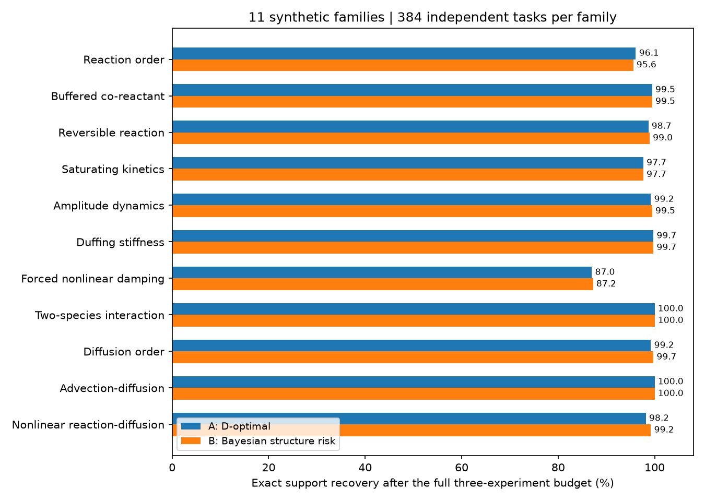

# Results: what is supported, and what is not

## Main synthetic benchmark

**4,224 independent tasks** = 11 families × 2 noise levels × 192 draws. Four policies evaluated on one task are paired alternatives, not four independent tasks. Each starts with one common acquisition and receives at most three new runs. Every acquisition has duration 1.5 and 16 observation times per channel.

The main metric is exact recovery of the optional term set after the full budget. Initial states, signs and specified base mechanisms are known. Two optional terms yield four supports. About 35.9% of tasks have neither optional term; nonempty-support results are reported separately below.

| Family | Random | Prior-optimized fixed | A: D-optimal | B: Structure risk |
|---|---:|---:|---:|---:|
| First-/second-order reaction | 92.19% | 95.57% | 96.09% | 95.57% |
| Buffered co-reactant | 97.40% | 99.22% | 99.48% | 99.48% |
| Reversible reaction | 97.92% | 98.96% | 98.70% | 98.96% |
| Linear/saturating kinetics | 91.93% | 97.40% | 97.66% | 97.66% |
| Amplitude dynamics | 95.83% | 99.22% | 99.22% | 99.48% |
| Duffing stiffness | 93.75% | 99.74% | 99.74% | 99.74% |
| Forced nonlinear damping | 83.07% | 87.50% | 86.98% | 87.24% |
| Two-species interaction | 98.70% | 100.00% | 100.00% | 100.00% |
| Second-/fourth-order diffusion | 98.44% | 99.48% | 99.22% | 99.74% |
| Advection–diffusion | 100.00% | 100.00% | 100.00% | 100.00% |
| Nonlinear reaction–diffusion | 96.09% | 98.70% | 98.18% | 99.22% |

Overall: A = **97.7509%**, B = **97.9167%**, prior-optimized fixed = **97.7983%**, random = **95.0284%**. B−A is +0.1657 percentage points, paired bootstrap 95% interval [−0.1657, +0.4972]. None of the 11 family-specific A/B comparisons passes the original Holm-corrected threshold. There is no established general winner and no claimed improvement over all existing active-SINDy algorithms.

For **2,709 nonempty-support tasks**, A/B = 96.53%/96.75%. The forced nonlinear-damping case remains difficult (~87%); easier tasks must not hide it. The advection–diffusion case already has ~95.57% initial accuracy, so its final 100% is not a large active-learning gain.

## Early stopping is a different endpoint

All policies share the rule: stop at maximum structure posterior ≥95%; otherwise continue to the budget and label the result unresolved. Full paths are archived so full-budget accuracy can be compared separately. Early stopping never uses future correctness.

| Policy | Mean added runs | Single-structure declaration fraction | Accuracy among declarations | Unresolved |
|---|---:|---:|---:|---:|
| Random | 1.435 | 83.62% | 98.87% | 16.38% |
| Prior-optimized fixed | 1.023 | 93.16% | 99.19% | 6.84% |
| A: D-optimal | 1.035 | 92.40% | 99.28% | 7.60% |
| B: Structure risk | 1.004 | 93.61% | 99.14% | 6.39% |

Conditional declaration accuracy is **not** overall recovery. Forcing a MAP answer even on unresolved tasks gives early-stop accuracy 97.49%/97.56% for A/B. This is not the same as 97.75%/97.92% at full budget.

## Known limitations

A two-term, sign-constrained library with matched truth/prior/noise is not open-ended symbolic discovery. Some modes or radial projections are known. The nonlinear reaction–diffusion test is a 32-site periodic method-of-lines model, not an arbitrary PDE solver benchmark. Noise levels are dimensionless toy choices, not equal real-world difficulty. Experimental time and sample counts match; reagent, preparation, energy and money do not.

The posterior is conditional on the candidate library. Missing physics may lead to confident wrong in-library conclusions. Unknown correlated noise and near-zero effects excluded by the prior also invalidate naive interpretations. The main result table is not a claim of coverage under these shifts.

## Exploratory archives, not completed extensions

Three-or-more mechanisms and trustworthy unknown noise modeling are **future work**. Their preliminary pilot/stress records are preserved rather than hidden: `benchmark/stress/reaction3/`, `benchmark/stress/robustness/`, and `benchmark/stress/noise_aware/`. The last reuses the same 192 correlated-noise worlds with the true covariance supplied; it is an oracle diagnostic, not a noise-learning method.

The historical evaluation count including these separate studies is 5,088. The public main benchmark remains 4,224; exploratory tests are not pooled into its success rate. See [the roadmap](ROADMAP.md).

## Numerical evidence and reproducibility

Original checks include independent integration, sensitivity, grid, quadrature and predictive-integration refinement. Main posterior quadrature refinement (263 fixed datasets, order120→240) changed no sampled MAP decision or 95% stopping decision. The Bayesian acquisition estimator can still change actions on refinement; it is not an exact expected-risk oracle.

This packaging turn preserved the original numerical archive and recomputed its summary tables. It did **not** rerun 4,224 tasks or re-establish original performance. The demo is run afresh as a small executable check; the three STLSQ controls are new deterministic diagnostics, not added benchmark trials.

[Paired comparisons](../benchmark/paired_comparisons.csv) · [Original detailed report](../benchmark/RESULTS.md) · [Package checks](../artifacts/package_validation.json) · [Main records (gzip)](../benchmark/replication/trials.csv.gz)
